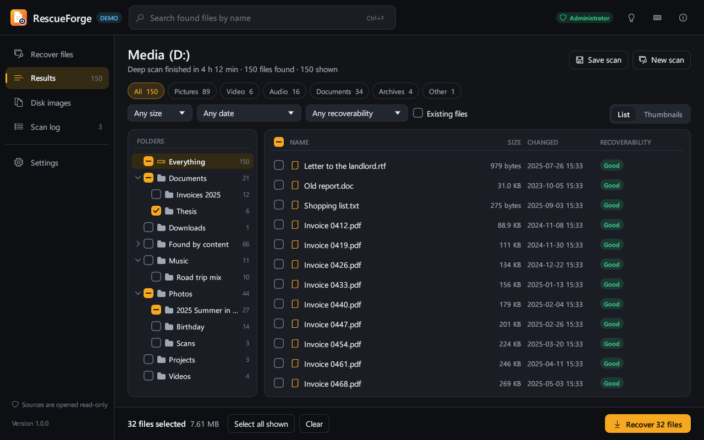
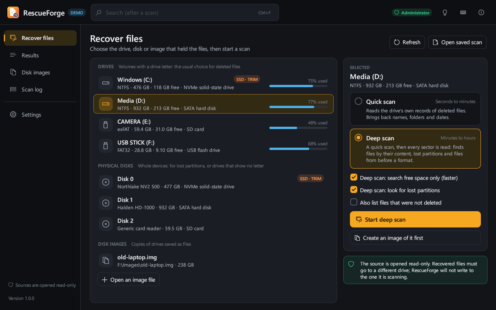
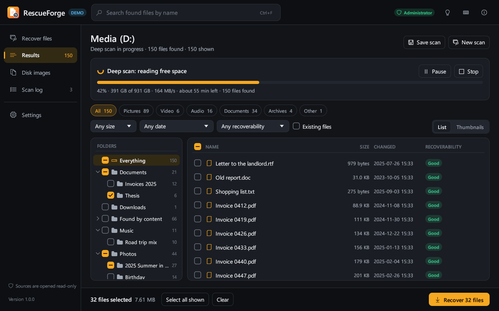
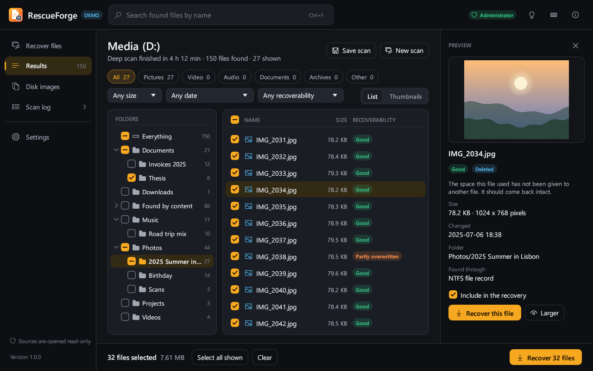
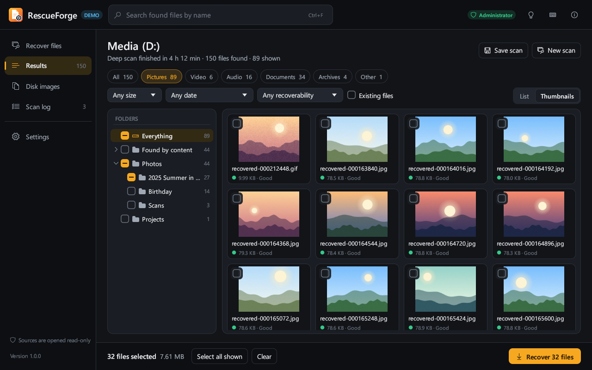
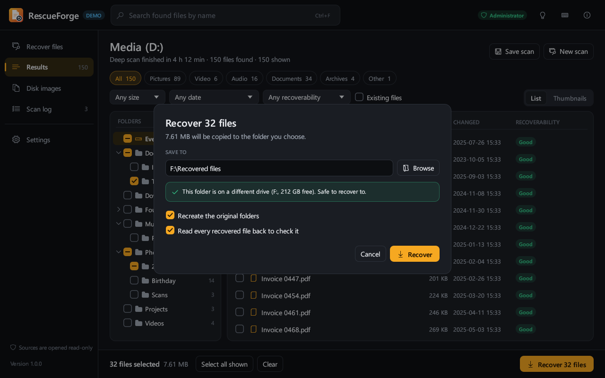
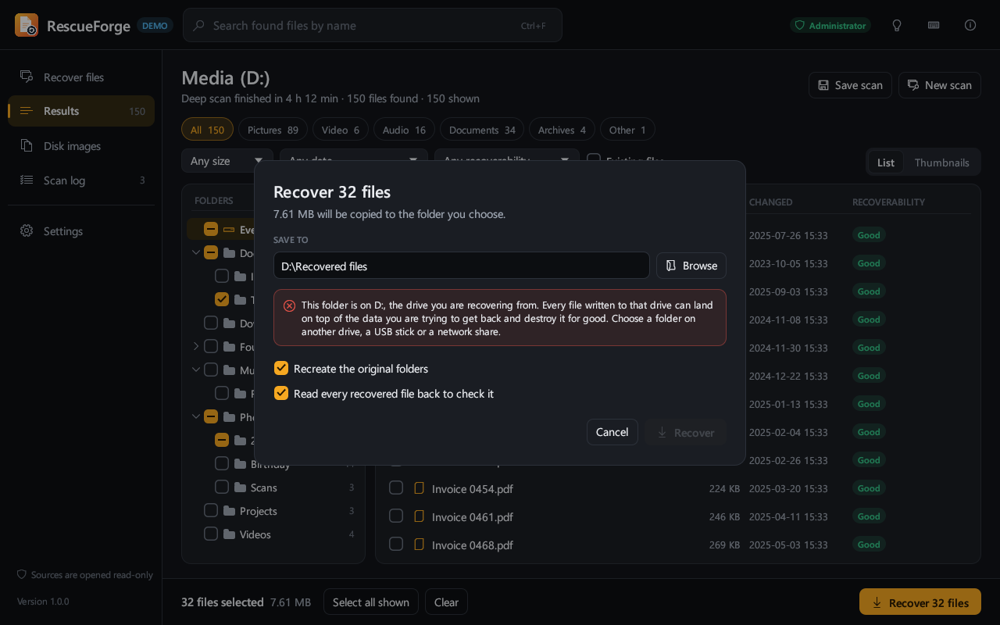
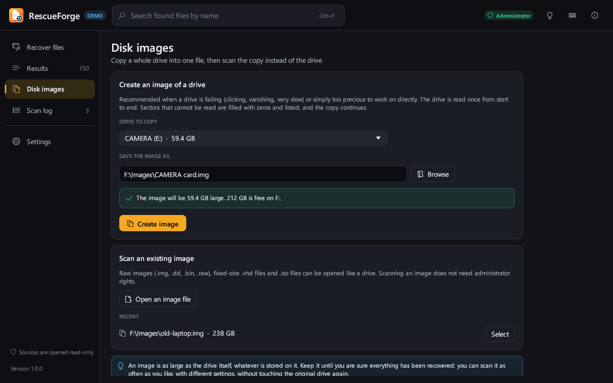
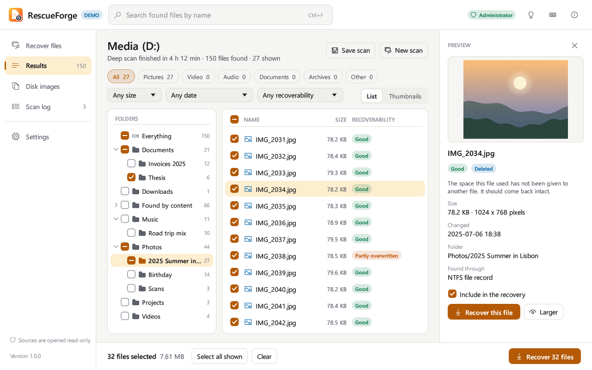

<div align="center">


# RescueForge

### Get deleted files back: photos, documents, video, everything.

A file recovery program for Windows, written in **Rust**.
A quick scan brings back recently deleted files with their names and folders. A deep scan reads every sector to find files by their content, lost partitions, and files from before a format.

<p>
  
  
  
  
</p>

<p>
  
  
  
  
  
  
  
</p>

[**First steps**](#-if-you-just-lost-files) ·
[**Features**](#-features) ·
[**Screenshots**](#%EF%B8%8F-screenshots) ·
[**Download**](#-download) ·
[**Limits**](#-what-recovery-can-and-cannot-do) ·
[**Developer**](#-developer)



</div>

---

## 🚑 If you just lost files

1. **Stop using that drive.** Every new file written to it can overwrite what you want back.
2. **Do not install RescueForge on that drive.** Use the portable ZIP from another drive or a USB stick.
3. **Recover to a different drive.** RescueForge refuses to save onto the drive it is scanning.
4. Try a **quick scan** first, then a **deep scan** if the files are not there.

> [!NOTE]
> **First release.** Scanning and recovery have been tested end to end on disk images, including images made by other operating systems' own formatting tools. Reading a physical drive directly needs administrator rights and has not yet been tested on real hardware. If your data matters a lot, make a disk image first (RescueForge can do it) and scan the image.

## ✨ Features

<table>
<tr>
<td width="50%" valign="top">

### ⚡ Quick scan
- Reads the drive's own records of deleted files
- **NTFS, FAT12/16/32 and exFAT**
- Brings back names, folders and dates
- Rates every file: good, partly overwritten or overwritten
- Seconds to minutes

</td>
<td width="50%" valign="top">

### 🔬 Deep scan
- Reads every sector and finds files by their content
- About 45 kinds of file, with the real end of each file worked out from its structure
- Finds **lost partitions** and rebuilds folders after a quick format
- Option to search free space only, which is faster

</td>
</tr>
<tr>
<td valign="top">

### 🗂️ All kinds of file
- **Pictures:** JPEG, PNG, GIF, BMP, TIFF, WebP, HEIC, PSD, camera RAW
- **Video and audio:** MP4, MOV, AVI, MKV, WMV, MP3, WAV, FLAC, OGG
- **Documents:** PDF, Word, Excel, PowerPoint (new and old formats), RTF, text
- **More:** ZIP, RAR, 7z, programs, databases, mail stores

</td>
<td valign="top">

### 🧭 Easy to navigate
- Folder tree with original paths, tick boxes per folder
- Filter by type, size, date and recoverability; search by name
- List or thumbnail grid
- **Preview** pictures, text or raw bytes before recovering
- Running total of files and size selected

</td>
</tr>
<tr>
<td valign="top">

### 💾 Sources
- Drives with a letter, with an SSD / TRIM warning where it applies
- Whole physical disks, for lost partitions
- **Disk image files**
- **Create an image first**, skipping bad sectors, then scan the image

</td>
<td valign="top">

### 🛟 Safe and patient
- The source is always opened **read-only**
- Refuses to recover onto the drive being scanned
- Checks each recovered file by reading it back
- Pause, resume and stop; use results while the scan is running
- Save a scan and reopen it later without rescanning

</td>
</tr>
</table>

## 🖼️ Screenshots

<table>
<tr>
<td width="50%" align="center"><b>Choose a source and a scan</b><br></td>
<td width="50%" align="center"><b>Scanning</b><br></td>
</tr>
<tr>
<td width="50%" align="center"><b>Preview before recovering</b><br></td>
<td width="50%" align="center"><b>Thumbnail grid</b><br></td>
</tr>
<tr>
<td width="50%" align="center"><b>Recover to another drive</b><br></td>
<td width="50%" align="center"><b>Refused: same drive</b><br></td>
</tr>
<tr>
<td width="50%" align="center"><b>Disk images</b><br></td>
<td width="50%" align="center"><b>Light theme</b><br></td>
</tr>
</table>

<sub>Screenshots use the built-in demo mode (<code>RescueForge.exe --demo</code>), with an invented disk and files.</sub>

## 📥 Download

Get it from the [**latest release**](https://github.com/zheerkhalid/rescueforge/releases/latest):

| File | What it is |
|---|---|
| `RescueForge-x.y.z-portable-x64.zip` | Portable: unzip and run. **Use this if the lost files were on your main drive** |
| `RescueForge-Setup.exe` | Installer with shortcuts and an uninstaller |
| `RescueForge.exe` | The bare 7.5 MB EXE |

Windows asks for administrator rights when you start it; reading a drive directly needs them. Without them you can still scan disk image files.

## 📌 What recovery can and cannot do

No program can promise your files back. What decides it:

- **SSDs with TRIM** usually erase deleted data within moments. RescueForge marks such drives. A quick scan is still worth trying, but expect less.
- **Overwritten data is gone.** The recoverability rating tells you which files are affected.
- **Files found only by content** come back without their name or folder, and a file that was stored in scattered pieces may come back damaged.
- **Deleted files that were fragmented on FAT drives** may come back damaged.
- **Compressed NTFS files** are listed but not decompressed; **encrypted (EFS) files** come back still encrypted.
- **Encrypted drives** (BitLocker and similar) must be unlocked first.
- Not read in this version: Linux, macOS and ReFS file systems, and VHDX, VMDK or dynamic VHD images.

More in [`docs/HOW-IT-WORKS.md`](docs/HOW-IT-WORKS.md).

## 🏗️ Build from source

Requires Rust (stable, MSVC toolchain) on Windows.

```powershell
git clone https://github.com/zheerkhalid/rescueforge
cd rescueforge
cargo build --release
# -> target\release\RescueForge.exe
cargo test
```

| Command | What it does |
|---|---|
| `RescueForge.exe --demo` | An invented disk; nothing real is read |
| `RescueForge.exe <image> [--deep]` | Open and scan a disk image |
| `RescueForge.exe --selftest` | Build FAT, exFAT and NTFS images, delete files, scan, recover and compare every byte |

The self-test also covers a quick format, a lost partition, imaging with bad sectors, and confirms the scanned images are unchanged.

The icon is drawn in code at build time. The C runtime is linked statically, so the EXE runs on a clean Windows install.

## 👨‍💻 Developer

<table>
<tr>
<td align="center" width="140">
  <a href="https://zheer.dev">
    
  </a>
</td>
<td>

**Designed and developed by [Zheer Khalid](https://zheer.dev)**

🌐 Website: **[zheer.dev](https://zheer.dev)**  
🐙 GitHub: **[@zheerkhalid](https://github.com/zheerkhalid)**  
🧩 Also by Zheer: **[SnapForge](https://github.com/zheerkhalid/snapforge)**, **[ReelForge](https://github.com/zheerkhalid/reelforge)**, **[UnForge](https://github.com/zheerkhalid/unforge)**, **[KeepForge](https://github.com/zheerkhalid/keepforge)**, **[ShredForge](https://github.com/zheerkhalid/shredforge)**, **[BootForge](https://github.com/zheerkhalid/bootforge)**, **[WireForge](https://github.com/zheerkhalid/wireforge)**, **[TwinForge](https://github.com/zheerkhalid/twinforge)** and **[SpaceForge](https://github.com/zheerkhalid/spaceforge)**

If RescueForge got your files back, a ⭐ on the repo is appreciated.

</td>
</tr>
</table>

## 📄 License

MIT © 2026 [Zheer Khalid](https://zheer.dev). See [`LICENSE`](LICENSE).

<div align="center">
<sub>Built with 🦀 Rust and ❤️ by <a href="https://zheer.dev">zheer.dev</a></sub>
</div>
